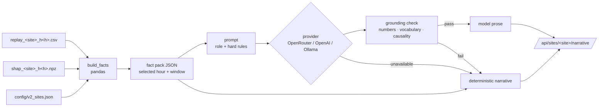

# AMAKA — Grounded chart explanation

The load trace shows *what* happened. The explanation panel answers *what am I looking
at, and why does it matter* in two short paragraphs: one for the selected hour, one for
the visible window. It also accepts a free-text question about the same window.

This is **not** a new forecasting model and **not** a chatbot over raw CSV rows. The
numbers are computed in Python; the language model only turns a bounded fact pack into
prose. If the prose contains a number that is not in the fact pack, it is rejected and
the deterministic rule-based narrative is shown instead.

The design is deliberately the opposite of "paste the chart into an LLM": it is a
**grounded natural-language generation layer** over the existing replay, SHAP archive and
alert rules.

---

## 1. Architecture



The same fact pack always produces the rule-based narrative you see in *fast* mode. The
model adds fluency, not new facts.

### Fact pack

`backend/narrate.py:build_facts()` computes, for one `(site, horizon, selected hour,
window)`:

| Group | Examples |
|---|---|
| Site and model | site label, location, type, served model, residual learner |
| Selected hour | actual, forecast, Stage-1 XGB, residual adjustment, error kW/% |
| Selected hour state | readiness R1–R4, headroom/shortfall, inside/outside 95% range, weather |
| Model attribution | top three SHAP inputs with signed kW contributions |
| Window | row count, actual/forecast averages, min/max and when they occurred |
| Threshold pressure | hours over the peak threshold, hours within 3%, maximum overshoot |
| Error | MAE, RMSE, MAPE, bias, largest miss and its timestamp |
| Context | high-readiness hours, readiness mix, trend, temperature/humidity/cloud |

Everything is rounded once, server-side. The model never sees the full replay series, so
it cannot average, extrapolate or "find" a different peak.

---

## 2. The grounding contract

The system prompt (`backend/narrate.py:_system_prompt`) enforces seven rules:

1. Use only numbers in the fact pack; omit null values.
2. The data is a historical replay of 2025 H2 — past tense, never "will".
3. Vocabulary: *forecast* not *prediction*, *site* not *facility*, *load* not *demand*
   (see `docs/VOCABULARY.md`).
4. Readiness levels are spelled out: R1 exercise surge … R4 routine.
5. SHAP inputs are **attributions**, not proven causes. Never say "because" or "caused".
6. No orders or recommendations; describe the chart.
7. Two short paragraphs, under 100 words, no markdown.

After generation, `_grounded()` applies a second, independent check:

- **Numeric check.** Every numeric token in the answer must match a value in the fact
  pack (within 0.06 or 0.05% relative, allowing one-decimal rounding). Structural
  numbers (R1–R4, 95%, 24/48/72 hours, years) are allowed. A hallucinated `99,999 kW`
  fails and falls back.
- **Vocabulary check.** Rejects *prediction*, *facility*, *installation*, *demand*,
  future-tense *will*, and causal language (*because*, *caused*).
- **Format check.** Rejects headings, bullets and over-long answers.
- **Length check.** Rejects empty or truncated answers.

For Q&A, numbers in the user's question are also allowed (so "what happened at 18:00?"
can be answered). The question is delimited in the prompt and labelled untrusted; the
system instruction takes precedence.

The fallback is not a degraded error state. It is generated from the same facts and
passes the same grounding check; it simply lacks the model's phrasing. This keeps the
demo alive offline and makes the comparison honest.

---

## 3. Runtime behaviour

### Two-phase fetch in the UI

`frontend/src/components/ChartNarrative.tsx` never blocks the chart:

1. **Rules (fast).** `GET …/narrative?mode=fast` after a 220 ms debounce. Deterministic,
   no model call, instant. This text is visible immediately.
2. **Model (auto).** `GET …/narrative?mode=auto` after a further 1.1 s, only while the
   replay is paused. A valid model answer replaces the rules text; the chip changes
   from `RULES` to `LLM`.
3. **Replay.** While the replay is running, only the fast rules pass updates. Model
   refinement waits until the user pauses. This avoids a model call every replay tick.
4. **Ask.** The question box is shown to the Energy Manager and Analyst roles. It uses
   `POST …/narrative/ask`; the Commander sees the narrative but not the Q&A box, matching
   the role budget in `docs/DASHBOARD_PRINCIPLES.md`.

### Caching and failure containment

| Control | Value |
|---|---|
| Server answer cache | 256 entries, keyed by fact pack + role + model + question |
| Client answer cache | 200 entries, keyed by site + horizon + role + hour + window |
| Provider concurrency | 2 simultaneous calls |
| Circuit breaker | 2 consecutive failures → model paused for 5 minutes |
| Client retry hold-off | 5 minutes after `not_configured` / `provider` / `breaker` |
| Model timeout | 30 s (`SENTINEL_LLM_TIMEOUT`) |

`fallback_reason` is part of the API response so the UI can distinguish a dead provider
from a grounding rejection without parsing prose:

```json
{
  "source": "rules",
  "fallback_reason": "provider",
  "notice": "The explanation model rejected its credentials; showing the rule-based summary."
}
```

---

## 4. Providers and configuration

The backend supports any OpenAI-compatible `/chat/completions` endpoint and local
Ollama. Configuration is environment-only; the key never reaches the browser.

| Variable | Default | Notes |
|---|---|---|
| `SENTINEL_LLM_PROVIDER` | auto-detect | `openrouter`, `openai`, `ollama` or `off` |
| `SENTINEL_LLM_MODEL` | provider default | e.g. `google/gemini-2.5-flash` |
| `SENTINEL_LLM_BASE_URL` | provider default | OpenAI-compatible base URL |
| `SENTINEL_LLM_API_KEY` | `OPENAI_API_KEY` | never exposed by the API |
| `SENTINEL_LLM_TIMEOUT` | `30` | seconds |
| `SENTINEL_LLM_MAX_TOKENS` | `260` | output cap |

Provider defaults:

| Provider | Model | Base URL |
|---|---|---|
| `openrouter` | `google/gemini-2.5-flash` | `https://openrouter.ai/api/v1` |
| `openai` | `gpt-4.1-mini` | `https://api.openai.com/v1` |
| `ollama` | `qwen2.5:3b-instruct` | `http://127.0.0.1:11434` |

Examples (PowerShell):

```powershell
# OpenRouter
$env:SENTINEL_LLM_PROVIDER = "openrouter"
$env:SENTINEL_LLM_MODEL    = "google/gemini-2.5-flash"
$env:SENTINEL_LLM_API_KEY  = "sk-or-v1-..."

# Local Ollama (pull once: ollama pull qwen2.5:3b-instruct)
$env:SENTINEL_LLM_PROVIDER = "ollama"
$env:SENTINEL_LLM_MODEL    = "qwen2.5:3b-instruct"

# Rules only (offline demo)
$env:SENTINEL_LLM_PROVIDER = "off"
```

`GET /api/health` reports the active configuration without the key:

```json
"narrative": {"provider": "openrouter", "model": "google/gemini-2.5-flash",
              "configured": true, "breaker_open": false}
```

> **Deployment note.** The dashboard is synthetic, but the architecture is the argument
> for a defence context: a provider-agnostic backend can point at an on-premises model,
> so operational data never leaves the network. For the capstone demo, `openrouter` is
> the default because it gives the best prose per shilling; `ollama` proves the on-prem
> path.

---

## 5. API

### `GET /api/sites/{site}/narrative`

| Parameter | Meaning |
|---|---|
| `site` | site id |
| `at` | selected hour (ISO, optional; default latest) |
| `from`, `to` | visible window (ISO, inclusive; default 72 h ending at `at`) |
| `horizon` | `1`, `6`, `24`, `48` (default 24) |
| `role` | `commander`, `operator`, `analyst` (default `operator`) |
| `mode` | `auto` (model + fallback) or `fast` (rules only) |

Response:

```json
{
  "site": "peter_zuze",
  "horizon": 24,
  "role": "operator",
  "at": "2025-09-09T18:00:00",
  "window": {"from": "2025-09-06T18:00:00", "to": "2025-09-09T18:00:00"},
  "text": "On 9 Sep 2025 at 18:00, actual load was 4,521 kW …",
  "source": "model",
  "model": "google/gemini-2.5-flash",
  "cached": false,
  "notice": null,
  "fallback_reason": null,
  "facts": { "...": "the exact fact pack used for grounding" }
}
```

### `POST /api/sites/{site}/narrative/ask`

```json
{
  "question": "How accurate was the forecast?",
  "at": "2025-09-09T18:00:00",
  "from": "2025-09-06T18:00:00",
  "to": "2025-09-09T18:00:00",
  "horizon": 24,
  "role": "analyst"
}
```

Response: `{answer, source, model, cached, notice, fallback_reason, question}`.

`source` is `model` only when the answer passed the grounding check; otherwise
`source` is `rules` and the answer comes from the deterministic responder. The responder
covers peak, threshold/headroom, error/accuracy, readiness, drivers, weather, trend,
average and range questions.

---

## 6. Evaluating the feature for the thesis

The useful claim is not "the LLM is accurate". It is **"grounding makes the LLM safe
enough to use as an explanation layer"**. A defensible evaluation:

### Ablations

| Arm | What it does | Expected result |
|---|---|---|
| A — Rules only | `mode=fast` | 100% numeric grounding by construction; lower fluency |
| B — Ungrounded LLM | no fact pack, raw window summary | more fluent, but invented numbers/claims; do not ship |
| C — Grounded LLM | this implementation | fluent and numerically consistent; some grounding rejections |

### Measures

1. **Numeric grounding pass rate** — answers accepted by `_grounded()` / total model
   answers. Report per site, horizon and role.
2. **Factual consistency** — sample 30–50 answers; two raters mark each numeric claim as
   supported / unsupported by the chart. Report agreement (Cohen's κ).
3. **Coverage** — does the answer mention the expected facts for the role? (peak,
   headroom, readiness, top driver, error).
4. **Latency and cost** — time to first text (rules) vs model refinement; tokens and
   ZMW/USD per 1,000 explanations.
5. **Fallback rate** — `not_configured` / `provider` / `breaker` / `grounding`.
6. **User preference** — blind A/B of rules vs grounded LLM on the same 10 windows.

The fact pack is returned in the API response, so a reviewer can audit any sentence
against its evidence without reading code.

### Reproducible checks

```powershell
python tests/smoke_narrate.py   # fact packs, fallback, grounding, cache, no-model path
python tests/smoke_api.py       # full API surface; forces SENTINEL_LLM_PROVIDER=off
```

`smoke_narrate.py` includes a deliberate hallucination (`99,999 kW`) and a deliberate
vocabulary violation (*prediction*, *facility*); both must fall back. Those two checks
are the empirical core of the grounding claim.

### Known limitations

- Facility load is synthetic; the explanations describe a simulation, not real Zambian
  defence demand.
- SHAP values explain the Stage-1 XGBoost prediction, not the served hybrid forecast.
  The narrative says "the model's largest input was…", never "this caused the load".
- The provider can be wrong in ways the numeric check does not catch: a vague claim, a
  missing caveat, or an over-confident tone. Human review is still the evaluation.
- The Q&A is single-turn; it has no conversation memory.
- The demo environment's OpenRouter key can expire. The rules path is the safety net,
  and `SENTINEL_LLM_PROVIDER=off` gives a fully offline demo.

---

## 7. Files

| File | Role |
|---|---|
| `backend/narrate.py` | fact pack, prompts, providers, grounding, fallback, cache |
| `backend/app.py` | `GET …/narrative`, `POST …/narrative/ask`, health capability |
| `frontend/src/components/ChartNarrative.tsx` | panel, two-phase fetch, Q&A |
| `frontend/src/api.ts` | `fetchNarrative`, `askNarrative` |
| `frontend/src/types.ts` | `NarrativeResponse`, `NarrativeFacts`, fallback reasons |
| `tests/smoke_narrate.py` | offline unit/smoke coverage |
| `tests/smoke_api.py` | endpoint coverage with the model forced off |
