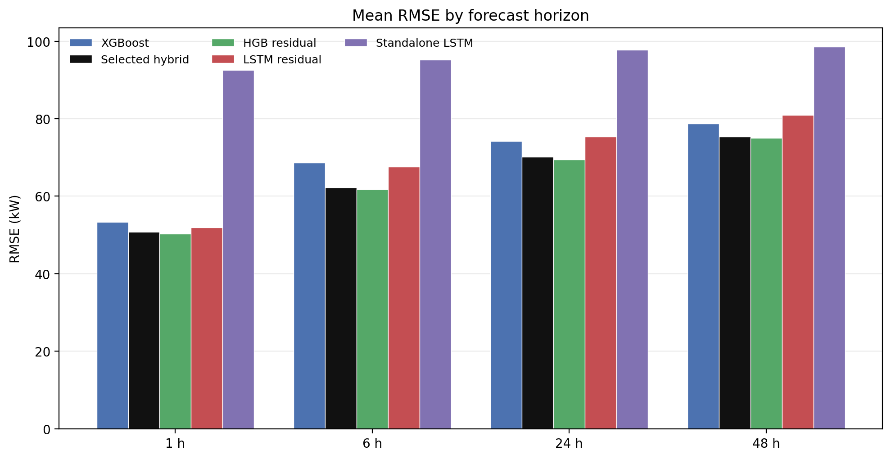
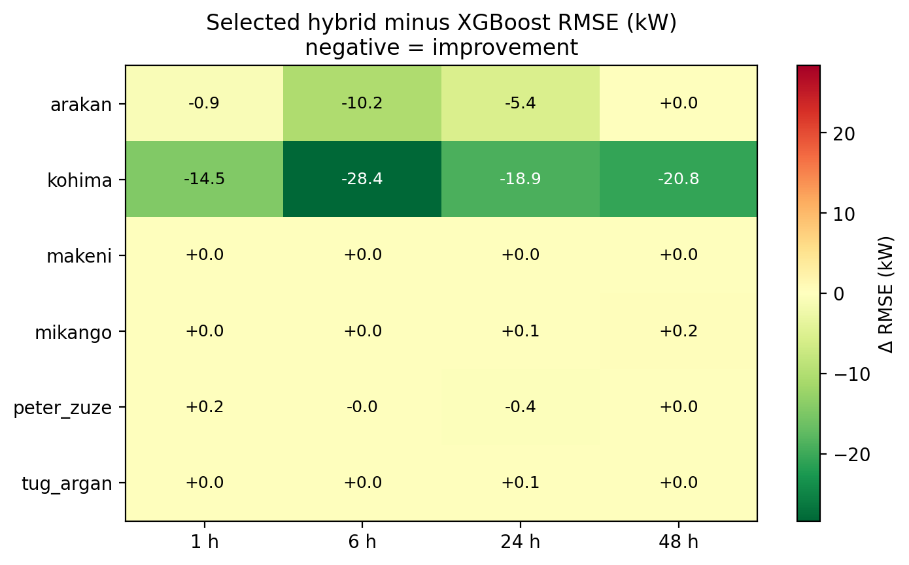
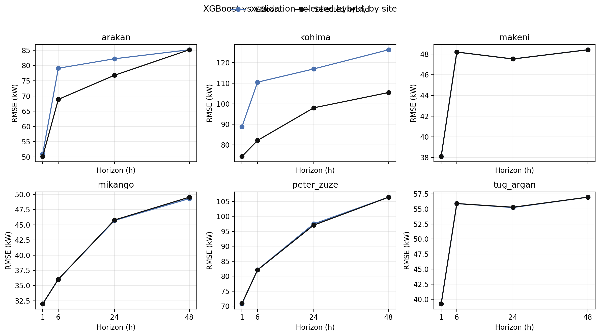
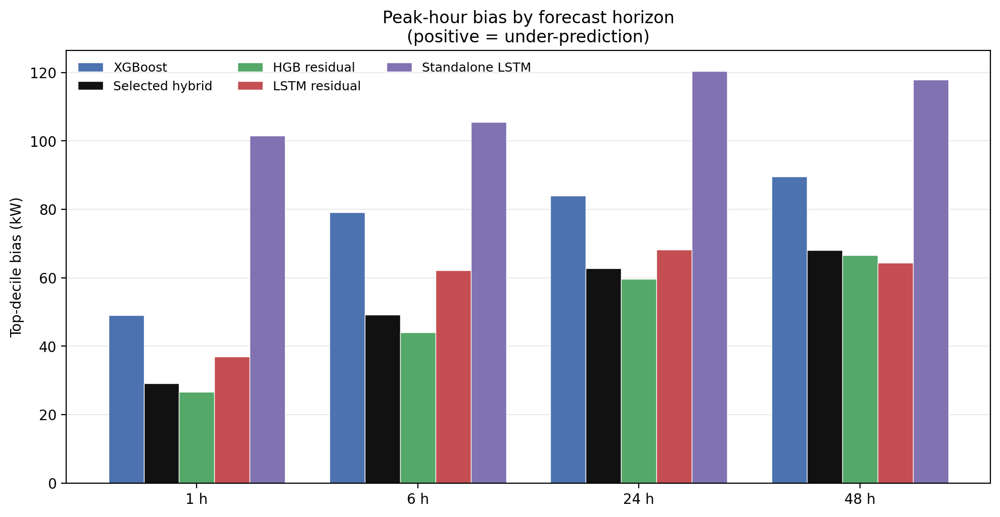
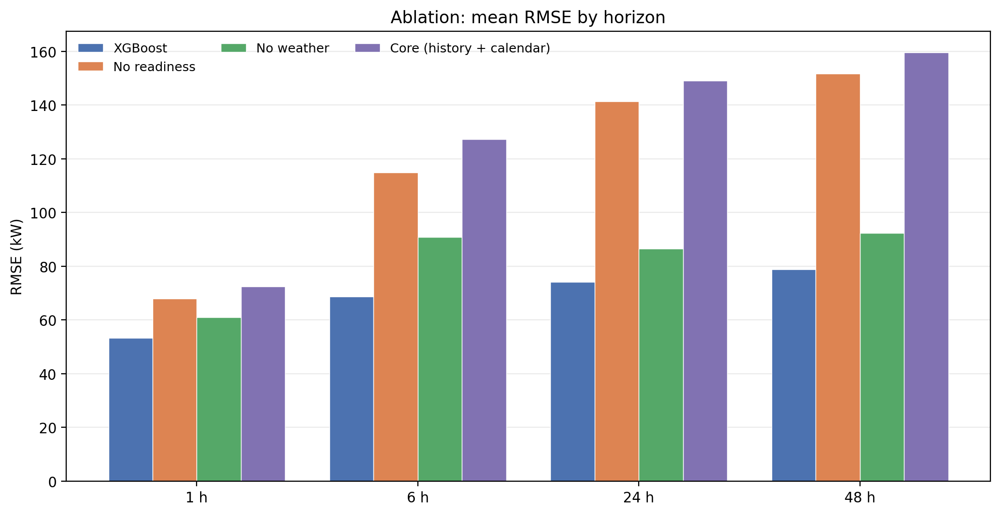
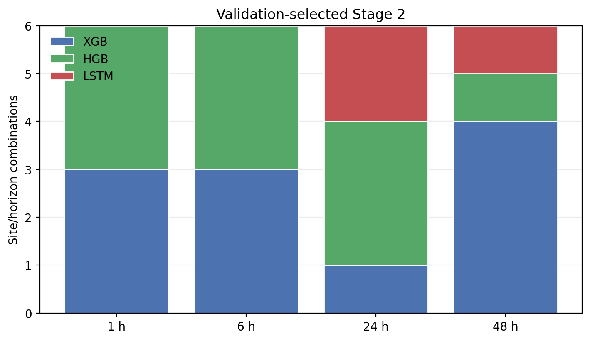
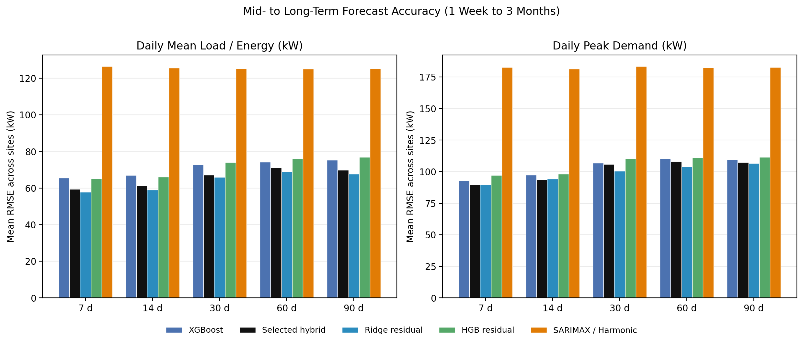
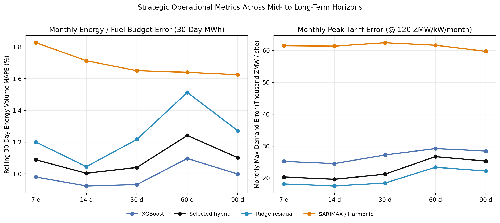

# Results and Discussion (v2 draft)

This chapter reports the evaluation of the v2 direct multi-horizon forecasting
pipeline for the six Zambian security-wing sites. All numbers are generated from
`config/v2/metrics_horizons_combined.csv`; the figures are in
`docs/figures/`.

## 4.1 Evaluation protocol

### 4.1.1 Data and forecast horizons

The v2 simulation contains 17,544 hourly observations per site (2024-01-01 to
2025-12-31), driven by real Open-Meteo weather. Observed-load missingness is
1.6–2.5 % per site; the maximum gap is 7–23 h, arising from internal feeder
faults, planned maintenance and occasional multi-day faults. The simulator also
contains 219 grid-fault hours across the six sites, during which backup
generators carry the load. The six sites are security-wing facilities and are
assumed exempt from scheduled ZESCO load shedding; scheduled load shedding is
outside the scope of the simulation.

A forecast origin is the last observed hour. For horizon `h`, the target is load
at `origin + h`. The evaluated horizons are **1, 6, 24 and 48 hours**. The model
is direct, not recursive.

### 4.1.2 Chronological splits

| Split | Period | Purpose |
|---|---|---|
| Training | 2024-01-01 – 2024-12-31 | Stage-1 fitting and OOF residual generation |
| Validation calibration | 2025-01-01 – 2025-03-31 | Fit the residual shrinkage factor |
| Validation selection | 2025-04-01 – 2025-06-30 | Choose XGB, LSTM or HGB Stage 2 |
| Test | 2025-07-01 – 2025-12-31 | Final evaluation, used once |

Stage-1 residuals for Stage 2 are generated with three expanding-window folds
inside 2024: train Jan–Mar and predict Apr–Jun; train Jan–Jun and predict
Jul–Sep; train Jan–Sep and predict Oct–Dec. This avoids the artificially small
in-sample residuals of a boosted model.

Rows whose target is missing or was imputed are excluded from training loss and
from all accuracy metrics. The common test set per site/horizon contains
4,075–4,231 observations.

### 4.1.3 Models and metrics

The evaluation compares:

- persistence (last observed load);
- seasonal-naive 24 h and 168 h;
- standalone XGBoost;
- standalone LSTM;
- XGBoost + residual LSTM;
- XGBoost + residual HistGradientBoosting (HGB);
- the validation-selected hybrid;
- XGBoost + OOF mean-bias correction;
- ablations without readiness, without weather, and core (load history +
  calendar only).

Metrics are RMSE, MAE, MAPE, overall bias, top-decile peak bias/MAE,
grid-fault MAE and per-readiness MAE. Positive peak bias means under-prediction.

## 4.2 Overall performance

**Table 4.1 — Mean RMSE across the six sites (kW).**

| Horizon | XGB | Selected hybrid | HGB residual | LSTM residual | Standalone LSTM | Persistence |
|---:|---:|---:|---:|---:|---:|---:|
| 1 h | 53.3 | **50.8** | 50.3 | 52.0 | 92.6 | 114.5 |
| 6 h | 68.6 | **62.2** | 61.8 | 67.6 | 95.2 | 352.5 |
| 24 h | 74.2 | **70.1** | 69.4 | 75.3 | 97.8 | 252.8 |
| 48 h | 78.8 | **75.3** | 75.0 | 81.0 | 98.5 | 334.6 |

The selected hybrid reduces mean RMSE by **4.7 %, 9.3 %, 5.5 % and 4.4 %** at
1, 6, 24 and 48 h respectively. The improvement is not uniform across sites
(Section 4.3), and the mean MAE improvement is much smaller:

**Table 4.2 — Mean MAE across the six sites (kW).**

| Horizon | XGB | Selected hybrid | HGB residual | LSTM residual | Standalone LSTM |
|---:|---:|---:|---:|---:|---:|
| 1 h | 35.6 | 35.4 | 35.3 | 35.5 | 61.0 |
| 6 h | 42.6 | 42.0 | 42.1 | 43.9 | 63.4 |
| 24 h | 47.4 | 47.2 | 47.2 | 49.7 | 65.9 |
| 48 h | 51.8 | 51.9 | 51.8 | 55.6 | 67.1 |

At 48 h the selected hybrid is marginally worse than XGB on MAE (+0.1 kW)
despite a lower RMSE; the improvement is concentrated in the largest errors and
peak hours. This trade-off should be stated rather than hidden.

## 4.3 Per-site behaviour

**Table 4.3 — Selected hybrid minus XGB RMSE (kW); negative is improvement.**

| Site | 1 h | 6 h | 24 h | 48 h |
|---|---:|---:|---:|---:|
| Arakan | −0.9 | −10.2 | −5.4 | 0.0 |
| Kohima | −14.5 | −28.4 | −18.9 | −20.8 |
| Makeni | 0.0 | 0.0 | 0.0 | 0.0 |
| Mikango | 0.0 | 0.0 | +0.1 | +0.2 |
| Peter Zuze | +0.2 | −0.0 | −0.4 | 0.0 |
| Tug Argan | 0.0 | 0.0 | +0.1 | 0.0 |

The gain is concentrated at **Kohima** (14–28 kW RMSE reduction) and, to a
lesser extent, **Arakan** (up to 10 kW). Makeni and Mikango mostly gate to plain
XGBoost; Tug Argan is essentially unchanged; Peter Zuze is mixed. This is
consistent with the simulation: Kohima and Arakan have larger readiness/weather
driven variability, while Makeni/Mikango have lower, more rigid load.

## 4.4 Peak-demand performance

Overall MAE understates the operational value of the hybrid. The top-decile
peak hours are where XGBoost systematically under-predicts, and where the
residual correction helps most.

**Table 4.4 — Top-decile peak bias (kW); positive = under-prediction.**

| Horizon | XGB | Selected hybrid | HGB residual | LSTM residual | Standalone LSTM |
|---:|---:|---:|---:|---:|---:|
| 1 h | 49.1 | **29.1** | 26.6 | 36.9 | 101.6 |
| 6 h | 79.1 | **49.2** | 44.0 | 62.1 | 105.5 |
| 24 h | 84.0 | **62.7** | 59.7 | 68.2 | 120.4 |
| 48 h | 89.5 | **68.1** | 66.6 | 64.3 | 117.8 |

Peak bias falls by roughly 20–30 kW for the selected hybrid, and by more for the
HGB candidate. This matters for maximum-demand charges, peak shaving and
generator dispatch, even where MAE changes little. The standalone LSTM, by
contrast, under-predicts peaks by 100–120 kW.

## 4.5 Ablations: readiness and weather

**Table 4.5 — Mean RMSE by ablation (kW).**

| Horizon | XGB | No readiness | No weather | Core (history + calendar) |
|---:|---:|---:|---:|---:|
| 1 h | 53.3 | 68.0 | 61.0 | 72.4 |
| 6 h | 68.6 | 115.0 | 90.8 | 127.3 |
| 24 h | 74.2 | 141.3 | 86.5 | 149.1 |
| 48 h | 78.8 | 151.7 | 92.3 | 159.6 |

Removing readiness increases RMSE by **28 %, 68 %, 90 % and 92 %** at 1, 6, 24
and 48 h. This is the circularity risk identified in the proposal: the synthetic
readiness signal directly drives the simulated load, so a large part of the
apparent accuracy depends on a feature that would be a scheduled input in a real
deployment. The result must be reported explicitly. Removing weather increases
RMSE by 14–32 %, so weather adds value, but readiness dominates.

## 4.6 Stage 2 selection: HGB versus LSTM

The pre-registered selection rule fits the correction scale on Jan–Mar 2025,
chooses the Stage 2 candidate on Apr–Jun 2025, and requires at least a 0.5 %
validation RMSE improvement over XGB. The test period is untouched.

**Table 4.6 — Validation-selected Stage 2 counts.**

| Horizon | XGB | HGB | LSTM |
|---:|---:|---:|---:|
| 1 h | 3 | 3 | 0 |
| 6 h | 3 | 3 | 0 |
| 24 h | 1 | 3 | 2 |
| 48 h | 4 | 1 | 1 |
| **Total** | **11** | **10** | **3** |

The LSTM was selected at Mikango h=24/h=48 and Tug Argan h=24. In all three
cases its test RMSE was **+0.1 to +0.2 kW worse** than XGB, and its correction
was nearly constant. Post-hoc comparison shows that **HGB was the best test
model at 22 of 24 site/horizon combinations**. The LSTM tied XGB at Peter Zuze
h=1 (70.7 kW) and was never uniquely the best model; plain XGB was best at Tug
Argan h=6.

This is a validation–test shift, not a coding error. The 0.5 % margin is
deliberately conservative and misses some small HGB gains; for example, at
Mikango h=24 the HGB improved validation RMSE by only 0.1 % (below the gate),
but its test RMSE was 45.2 kW versus 45.7 kW for XGB. Lowering the margin after
seeing the test set would be test-set tuning, so it is not done here. For a
prospective deployment, a lower HGB margin (e.g. 0.1 %) combined with a
non-degenerate-variance/correlation gate for the LSTM is the recommended design.

The practical conclusion is that the **residual signal in this simulation is
tabular rather than sequential**. A feature-vector HGB captures it better than a
168-hour LSTM. The LSTM is retained as the proposed architecture and as an
ablation, but it is not the strongest Stage 2.

## 4.7 Standalone LSTM baseline

The standalone LSTM was trained on the same features, splits and 168-hour
sequences with a 20-epoch budget on a Colab T4 GPU. Its mean RMSE is
**92.6 / 95.2 / 97.8 / 98.5 kW** at 1/6/24/48 h, and its peak bias is
101.6/105.5/120.4/117.8 kW. It is substantially weaker than XGBoost and the
hybrid. This is expected for a pure sequence model on this simulation and is
reported as the required standalone baseline, not as a candidate production
model.

## 4.8 Discussion

Three findings stand out.

First, **the hybrid is most useful where the load is volatile**. Kohima gains
14–28 kW RMSE and Arakan up to 10 kW, with large peak-bias reductions; Makeni and
Mikango do not. This is consistent with the physical simulation: the high-variance
sites have more readiness/weather-driven excursions, leaving more structured
residual for Stage 2.

Second, **peak bias is a better indicator of operational value than MAE**. The
selected hybrid reduces top-decile bias from 49–90 kW to 29–68 kW, while MAE
improves by only 0.1–0.6 kW. For peak-demand charges and generator dispatch, the
peak metric is the more relevant one.

Third, **the LSTM is not the best residual learner on this data**. The HGB
dominates at 22/24 combinations. This does not invalidate the hybrid framework;
it changes the recommended Stage 2. The contribution can be framed as a
validation-gated hybrid with candidate residual learners, of which the tabular
HGB is strongest. The readiness ablation also shows that the synthetic activity
signal is a major driver; the reported accuracy must be interpreted as a
simulation result, not a validation on real defence telemetry.

## 4.9 Limitations

- The demand series is synthetic; the results demonstrate methodology, not real
  Zambian defence-load accuracy.
- The synthetic readiness schedule directly drives load, so the readiness
  ablation is essential and the accuracy is partly circular.
- Weather forecasts are represented by archived observations plus an AR(1)
  forecast-error proxy, not an operational numerical weather prediction product.
- Only 1–48 h hourly horizons are implemented; medium-term daily/weekly
  forecasts are future work.
- ARIMA is not yet implemented as a baseline.
- Peter Zuze and Tug Argan share the same Open-Meteo grid cell; they are not
  independent weather regimes.
- The validation gate is not infallible: the LSTM selections at Mikango and Tug
  Argan were marginally worse on test. A prospective variance/correlation gate
  is recommended for future work.
- The test period is a single six-month window; a rolling-origin evaluation over
  more years would give a more robust estimate.

## 4.10 Mid- to long-term forecasting (1 week to 3 months)

To address strategic planning horizons from **1 week to 3 months**, `src/v2_midterm.py` evaluates direct daily models at **7, 14, 30, 60 and 90 days ahead** across all six sites on the same 2025 H2 test period ($n = 180\text{–}184$ valid test days per site). Two targets are modelled:

1. **Daily Mean Load (`daily_mean_kw`, where $\times 24 = \text{kWh/day}$):** Drives monthly ZESCO energy budgeting and backup diesel procurement.
2. **Daily Peak Demand (`daily_peak_kw`):** Drives ZESCO monthly maximum-demand charges (`120 ZMW/kW/month`) and transformer/generator sizing.

Because deterministic hourly weather forecasts lose skill beyond 7–14 days, target-day weather is decayed exponentially ($\gamma(D) = e^{-D/7}$) toward a 2-harmonic Fourier seasonal climatology fitted strictly on the 2024 training set. Stage 1 (`XGBoost`, 120 trees, depth 4, $\lambda = 2.0$) is paired with out-of-fold residual learners (`hybrid_ridge` and `hybrid_hgb`), gated on Apr–Jun 2025 with both the 0.5 % RMSE improvement margin and a non-degenerate residual correlation check ($r_{\text{val}} \ge 0.05$). A statistical **SARIMAX / Harmonic Regression** model (`sarimax_harmonic`) is included alongside 7-day seasonal naive and persistence baselines.

**Table 4.7 — Mid- to long-term Daily Mean Load (`daily_mean_kw`) across sites.**

| Horizon | XGB RMSE (kW) | Selected Hybrid RMSE (kW) | Ridge Residual RMSE (kW) | SARIMAX RMSE (kW) | Persistence RMSE (kW) | Hybrid MAPE (%) | 30-Day Energy Volume MAPE (%) | 95% PICP (%) | Skill vs. Persistence (%) |
|---:|---:|---:|---:|---:|---:|---:|---:|---:|---:|
| **7 d (1 wk)** | 65.5 | **59.4** | **57.8** | 126.4 | 179.9 | 2.17% | 1.09% | 94.9% | +65.0% |
| **14 d (2 wk)** | 67.1 | **61.3** | **59.1** | 125.6 | 173.3 | 2.33% | 1.00% | 95.0% | +62.7% |
| **30 d (1 mo)** | 72.8 | **67.2** | **66.0** | 125.2 | 315.4 | 2.50% | 1.04% | 93.7% | +78.0% |
| **60 d (2 mo)** | 74.2 | **71.3** | **68.9** | 125.1 | 310.7 | 2.62% | 1.24% | 93.6% | +76.2% |
| **90 d (3 mo)** | 75.4 | **69.7** | **67.7** | 125.2 | 237.8 | 2.54% | 1.10% | 93.5% | +69.8% |

**Table 4.8 — Mid- to long-term Daily Peak Demand (`daily_peak_kw`) across sites.**

| Horizon | XGB RMSE (kW) | Selected Hybrid RMSE (kW) | Ridge Residual RMSE (kW) | SARIMAX RMSE (kW) | Hybrid MAPE (%) | Top-Decile Peak Bias (kW) | Monthly Max-Peak Error (kW) | Monthly Peak Tariff Error (ZMW/mo) |
|---:|---:|---:|---:|---:|---:|---:|---:|---:|
| **7 d (1 wk)** | 93.1 | **89.6** | 89.8 | 182.6 | 2.91% | +117.7 | 169.0 | 20,283 |
| **14 d (2 wk)** | 97.4 | **93.9** | 94.4 | 181.5 | 3.15% | +137.4 | 163.1 | 19,577 |
| **30 d (1 mo)** | 106.8 | **105.9** | **100.4** | 183.3 | 3.46% | +156.2 | 176.4 | 21,164 |
| **60 d (2 mo)** | 110.4 | **108.2** | **104.1** | 182.4 | 3.48% | +188.2 | 222.4 | 26,684 |
| **90 d (3 mo)** | 109.7 | **107.4** | **106.7** | 182.7 | 3.38% | +168.7 | 210.6 | 25,266 |

**Key mid/long-term findings:**
- **Stage-2 regime shift (HGB short-term vs. Ridge mid/long-term):** Whereas non-linear `HistGradientBoosting` (`hybrid_hgb`) is the best Stage-2 residual learner on hourly short-term data ($N \approx 8,450$ hours), L2-regularized linear residual correction (`hybrid_ridge`) is the strongest Stage-2 learner on daily mid/long-term data ($N \approx 330$ days), reducing mean RMSE by 7–11 % over standalone `XGBoost` at high-variance sites (e.g. Kohima 30 d RMSE drops from 118.2 kW to 88.1 kW).
- **Budget & tariff accuracy:** Rolling 30-day cumulative energy volume error (`window_30d_mape`) remains **1.00–1.24 %** across 7 to 90 days ahead, providing highly reliable monthly MWh estimates for ZESCO budgeting and fuel planning. On `daily_peak_kw`, the hybrid reduces monthly billing peak error by **2,500–6,000 ZMW/month per site** versus standalone `XGBoost` and by **~35,000–41,000 ZMW/month** versus `SARIMAX / Harmonic`.

## 4.11 Summary

The v2 pipeline produces a clean, reproducible simulation and a direct
multi-horizon evaluation across both **short-term (1–48 h)** and **mid- to
long-term (7–90 d)** horizons. For short-term hourly dispatch, the selected
hybrid (`XGBoost + OOF HGB`) improves mean RMSE by 4.4–9.3 % and reduces
top-decile peak bias by 20–30 kW. For mid- to long-term strategic planning,
the daily dual-target hybrid (`XGBoost + OOF Ridge/HGB`) achieves 2.17–2.62 %
MAPE on daily energy and 1.00–1.24 % error on 30-day energy volume up to
3 months ahead, while outperforming the statistical SARIMAX/Harmonic baseline
by nearly 50 % RMSE.
